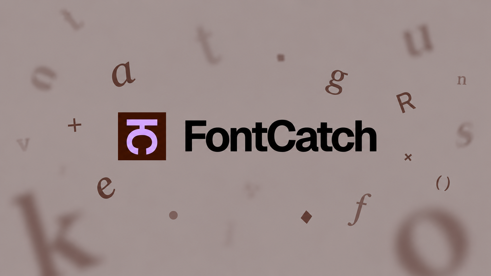

<p align="center">
  
</p>

# Fontcatch

**Download a font. Fontcatch handles the install.**

A small desktop app for designers who would rather try a typeface than dig through its ZIP file. Fontcatch watches your downloads, finds the desktop fonts inside, and installs them for you. Your fonts, previews and installation history stay together in a compact panel in your menu bar or system tray.

[Français](README.fr.md) · [How it works](#how-it-works) · [Get started](#get-started) · [Contributing](CONTRIBUTING.md) · [Report an issue](https://github.com/kooler98/FontCatch/issues) · [MIT license](LICENSE)

## Why Fontcatch?

You find the right typeface, download it, then the useful part stops. Unzip the archive. Find where it extracted. Open another folder. Sort through OTFs, TTFs, variable fonts, web fonts, README files and license documents. Find the version you wanted. Install it. Repeat for the next family.

Fontcatch takes care of the installation steps so you can get back to comparing type and designing. It is made for brand and graphic designers, UI designers, art directors, and anyone who regularly tries new typefaces. Front-end developers and designers preparing fonts for a website can also convert local files to WOFF2.

## How it works

1. **Leave Fontcatch running.** It watches Downloads by default. Add other folders in Settings if you need them.
2. **Download a font as usual.** ZIP archives and individual `.ttf`, `.otf` and `.ttc` files are supported. You do not need to unzip an archive or find its font folder yourself.
3. **Let Fontcatch install it.** Automatic is the default. When a family contains both variable and static alternatives, Fontcatch prefers the variable version; choose Static or Both in Settings instead. Switch to Ask me if you want to approve each installation.
4. **Open your library.** Preview the installed typeface, try another style, edit the sample text, adjust its size, or copy its name into your workflow.

Fontcatch watches **new downloads while it is running**. It does not install old files already sitting in a folder when the app starts or when you add that folder. Already recorded pending requests are resumed in Automatic mode. Updates to an installed font still require confirmation.

ZIP support covers standard ZIP32 archives using Store or Deflate compression, within size and metadata limits. ZIP64, split and encrypted archives are not supported. Web fonts (`.woff` / `.woff2`) cannot be installed.

## What you can do

| | |
| --- | --- |
| **Install from a ZIP** | Find and install the desktop fonts without manually extracting the archive. Unrelated ZIPs are ignored. |
| **Choose the versions you want** | Prefer variable fonts, static fonts, or both when a family offers alternatives. Duplicate PostScript names are checked before installation. |
| **Try the actual typeface** | Preview the installed font, change styles, type your own text and adjust the size. |
| **Export a web font** | Save the selected library style as WOFF2, or convert a local TTF/OTF without installing it. |
| **Find a font again** | Search the Fontcatch library by family, foundry or source; filter by type and download source when available. |
| **Keep useful details nearby** | Inspect styles, version information, source details and embedded license text or links. Reveal the installed file when you need it. |
| **Remove a family** | Review the files affected, then move the managed font files to Trash. Shared TTC collections list all affected families. |
| **Keep control** | Choose Automatic or Ask me, optional notifications, launch at login and optional ZIP cleanup after a successful install. |

**About licenses:** Fontcatch displays license information embedded in the font file. It does not read or interpret separate README files, PDFs or license documents inside a download. If the font does not include that metadata, the app says so. Keep the license supplied by the foundry; Fontcatch does not determine which uses it permits.

The library contains fonts installed through Fontcatch. It is not a catalog of every font already on your computer.

### Export WOFF2

Available in the **0.4.0 Windows preview** and source builds.

- **From the library:** select a style, then choose **Export WOFF2**. For a TTC collection, only the selected face is exported.
- **From a file:** choose **Convert file…** and select a `.ttf` or `.otf`. The font is converted without being installed or added to the library.

Choose a new filename and destination in the system's Save dialog. Conversion happens locally, one font at a time, with a 32 MiB input limit. Original files stay unchanged, and existing destination files are never overwritten. The export retains embedded license metadata; check that the font's license allows conversion and web use. WOFF2 is an export format here, not an installation input.

## Local by design

Fontcatch does not require an account, upload your font library, collect usage analytics or download fonts on your behalf. It works with the files you choose to download.

- Installs for the current user, without administrator privileges.
- Checks archives and font files, with limits on file size and extraction. It rejects unsafe archive paths and symbolic links.
- Leaves fonts installed outside Fontcatch untouched. Updates require confirmation, even in Automatic mode.
- Confirms uninstallation and checks that managed files have not changed before moving them to Trash.
- Keeps original downloads by default. ZIP cleanup is optional and only follows a successful installation.

Built with Tauri and Rust, using the system webview instead of bundling a browser runtime. The panel is 360 × 480, with English as the default language and French available in Settings.

See the [security and performance review](docs/security-and-performance.md) for the checks performed and known limitations, and [SECURITY.md](SECURITY.md) to report a vulnerability privately. This is an early alpha; local validation does not replace an independent security audit.

## Get started

**Current version: 0.4.0 alpha.**

**[Download Fontcatch for Windows x64](https://github.com/kooler98/FontCatch/releases/download/v0.4.0/Fontcatch_0.4.0_x64-setup.exe)** · [Release notes and SHA-256 checksums](https://github.com/kooler98/FontCatch/releases/tag/v0.4.0)

For **Windows 10/11 · x64**, download the `.exe` installer above, run it, then open Fontcatch from the Start menu. It installs for your account; if WebView2 is missing, the installer downloads it.

**macOS · Apple Silicon:** build from source using the instructions below. No macOS binary is available to download.

Keep Fontcatch running and download a new font. Use its icon in the menu bar or system tray to open your library and settings. Closing the panel leaves detection running; choose **Quit Fontcatch** from the icon's menu to stop the app.

The Windows preview installer is unsigned. macOS builds do not have distribution signing or notarization. Your operating system may warn about or block these builds.

The Windows 0.4.0 preview passed automated checks. Manual Windows 10/11 desktop testing remains pending.

| Platform | Recorded validation |
| --- | --- |
| macOS · Apple Silicon | Local 0.4.0 bundle tested before the Windows removal-retry fix: library-style and external-file WOFF2 export through native dialogs, independently decoded outputs, unchanged originals and Save cancellation. The library stayed usable while initial folder access was pending; after macOS access was granted, the warning cleared and the watcher started. A new real download has not yet been tested on 0.4.0; earlier installation/preview/removal checks apply to 0.3.4. |
| Windows 10/11 · x64 target | 0.4.0: [Windows CI passed](https://github.com/kooler98/FontCatch/actions/runs/40904840143): 99 Rust tests, a native font installation/removal smoke test, NSIS packaging and app startup checks. Manual desktop validation is still pending. |
| macOS · Intel | Not yet tested; no Intel preview build. |
| Linux | Experimental. Native behavior is unvalidated and a known GTK/glib dependency warning must be resolved before distribution. |

The Windows CI machine runs Windows Server 2022 x64 with an administrator account. It does not replace testing the interface on Windows 10/11 with a standard user account. Those manual checks remain pending, including tray behavior, display scaling and installation without elevation.

### Run from source

Install Node.js 22.12+ (tested with 24), a current stable Rust toolchain, and the [Tauri prerequisites for your platform](https://v2.tauri.app/start/prerequisites/). Then clone the project and run it:

```sh
git clone https://github.com/kooler98/FontCatch.git
cd FontCatch
npm ci
npm run desktop
```

Build a local application:

```sh
npm run desktop:build
# macOS application bundle only:
npm run desktop:build -- --bundles app
```

Local builds do not require distribution signing credentials. The optional `.tooling/` directory can provide a local Rust toolchain; on macOS, `.tooling/sdk-path` can select an installed SDK. Neither is included in the repository.

### Work on the interface

```sh
npm run dev
```

Open <http://127.0.0.1:1420>. Browser mode uses labeled sample data and separate settings. It cannot install fonts or access your native font library.

### Run checks

```sh
npm run build
npm test
npm run test:rust
npm run test:tooling
npm run test:ui
```

The ordinary Rust tests use temporary folders and simulated installation. Browser tests cover previews, filters, settings, license display and removal confirmations. They use Google Chrome when available on macOS, otherwise Playwright Chromium (`npx playwright install chromium`); `PLAYWRIGHT_CHROMIUM_EXECUTABLE` can select another executable.

Separate, opt-in macOS and Windows smoke tests install an original synthetic font into the real user Fonts folder, check native behavior, then remove it to Trash or the Recycle Bin. See [CONTRIBUTING.md](CONTRIBUTING.md) before running them.

## Data and project structure

Preferences use Tauri Store; font records and pending requests use SQLite. On macOS, app data is stored in `~/Library/Application Support/app.fontcatch.desktop/`. Private staged copies keep pending requests usable if the original download is moved. Installed files go to the current user's font directory.

| Area | Location |
| --- | --- |
| Screens and layout | `src/App.tsx`, `src/styles/app.css` |
| Colors and typography | `src/styles/tokens.css` |
| UI components | `src/components/beautiful-ui/` |
| English and French copy | `src/locales/` |
| Website, support and creator links | `src/config.json` |
| Brand assets | `src/assets/brand/`, `docs/assets/` |
| Detection, inspection and installation | `src-tauri/src/` |

Website and coffee links are unset until configured. Set HTTPS URLs in `websiteUrl` and `coffeeUrl` to enable those buttons. `npm run icons` regenerates app and tray icons from the supplied artwork.

## What's next

Manual Windows 10/11 testing, native validation on Linux and Intel macOS, resolving the Linux dependency warnings, signed installers and automatic app updates. Platform testing and focused bug reports are welcome — see [Contributing](CONTRIBUTING.md).

## License and credits

Fontcatch is open source under the [MIT license](LICENSE). Downloaded fonts retain their own licenses; Fontcatch's license grants no additional rights to use them.

Selected UI components are adapted from Beautiful UI by Shane Levine, with their MIT notice preserved. The original synthetic test fonts use CC0. See [THIRD_PARTY_NOTICES.md](THIRD_PARTY_NOTICES.md).

<p align="center">
  <br>
  Made by <a href="https://twitter.com/pierrreweb">@pierrreweb</a>
</p>
